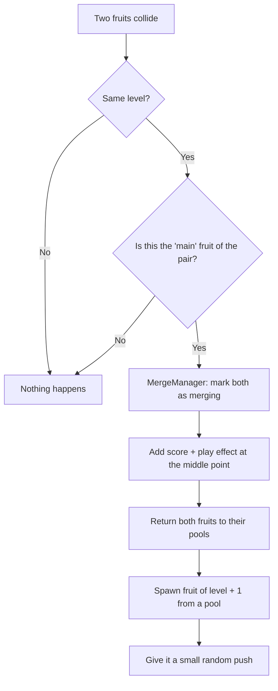

# 🍉 SuikaClone

A 2D physics puzzle game in the style of *Suika Game* (the "watermelon game"), built in **Unity 6** with **C#**.

Drop objects into a container. When two objects of the **same level** touch, they merge into one bigger object of the next level. Keep merging to score points, and don't let the pile reach the lose line.

> The project is built as a portfolio piece to practice clean code structure: object pooling, factories, dependency injection by hand, and automated tests.

## Gameplay

- Move the mouse to aim, **left click** to drop the object.
- Two objects of the same level merge into one of the next level (11 levels in total).
- Every merge gives score and plays a visual effect.
- If an object stays above the **lose line** for 5 seconds, the game is over.
- The **top 3 scores** are saved between sessions.
- After game over, objects keep falling on their own in the background, so the screen is never empty.

## How a merge works



The "main fruit" check (comparing instance IDs) makes sure a merge happens **once**, not twice, when both fruits notice the same collision.

## Tech stack

| Area | What is used |
|---|---|
| Engine | Unity 6 (`6000.3.11f1`) |
| Language | C# |
| Rendering | Universal Render Pipeline (2D) |
| Physics | Unity 2D Physics (`Rigidbody2D`, colliders, triggers) |
| UI | TextMeshPro / uGUI |
| Testing | Unity Test Framework (PlayMode tests) |

## Architecture

The code lives in `Assets/Scripts` and is split by responsibility:

```
Scripts/
├── Dependency Injjector/   GameBootstrapper – wires everything together
├── Fruits/                 Fruit, FruitData (ScriptableObject), FruitType
├── Managers/               Game, Merge, Score, HighScore, FruitSpawn, Effect
├── Factories/              Create fruit and effect objects from prefabs
├── Pools/                  Reuse objects instead of creating/destroying them
├── Player/                 PlayerController – aiming and dropping
├── InputManager/           Input reading behind an interface
├── Helpers/                Effect playback
└── LoseLine.cs             Lose condition
```

Main ideas used:

- **Object Pooling** – fruits and effects are created once and reused. This avoids lag from constant `Instantiate` / `Destroy`.
- **Factory pattern** – pools ask factories to create objects, so the pool does not need to know about prefabs.
- **Manual dependency injection** – `GameBootstrapper` creates the links between systems in one place instead of using singletons or `FindObjectOfType`.
- **Interfaces** – `IMergeHandler`, `IInputReader`, `IFactory<T>`, `IPool<T>` keep parts loosely connected and easy to test.
- **ScriptableObject data** – each fruit's level, score and type are stored in a `FruitData` asset, not hard-coded.
- **Assembly definitions** – runtime code and tests are separated (`SuikaClone.Runtime`, `SuikaClone.PlayModeTests`).

## Tests

PlayMode tests for merge logic live in `Assets/Tests/PlayMode`.
Run them in Unity: **Window → General → Test Runner → PlayMode → Run All**.

## Getting started

1. Install **Unity Hub** and **Unity 6000.3.11f1** (or a close 6000.x version).
2. Clone the repo:
   ```bash
   git clone https://github.com/z21-cloud/SuikaClone.git
   ```
3. Open the folder in Unity Hub (**Add → Add project from disk**).
4. Open the scene `Assets/Scenes/MainMenu.unity` and press **Play**.

## Possible next steps

- Show a preview of the next fruit
- Sound effects and music
- Mobile / touch controls
- Migrate input fully to the new Input System package

## Author

**Sergey** — [@z21-cloud](https://github.com/z21-cloud)
